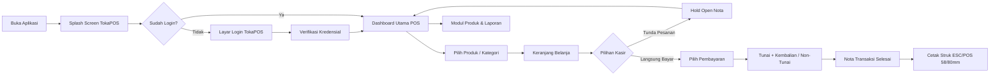

<p align="center">
  
</p>

# 📱 TokaPOS App - Modern Point of Sale & Automated E2E Testing Suite
### Ujian Tengah Semester (UTS) Mata Kuliah Mobile Testing
**Fakultas Ilmu Komputer, Universitas Duta Bangsa Surakarta**  
**Tahun Akademik 2026/2027**

---

## 👤 Informasi Mahasiswa & Proyek

| Informasi | Keterangan |
| :--- | :--- |nah 
| **Mata Kuliah** | Mobile Testing |
| **Dosen Pengampu** | Triyono M.Kom |
| **Program Studi** | S1 Teknik Informatika |
| **Kelas** | TI23B |
| **Nama Mahasiswa** | AFIF ADAM MUGHNANSYAH |
| **NIM** | 230103184 |
| **Nama Aplikasi** | **TokaPOS (Sistem Kasir Pintar & Modern)** |
| **Peran** | Mobile App Developer & QA / Automated Tester |
| **Tautan Repository Git** | https://github.com/Adamxmxm/smart_pos_testing_uts |
| **Tautan Video Penjelasan** | https://drive.google.com/drive/folders/1PM3Wx3KgyBK6DBSki5I4-JvC_0XjZSLL?usp=sharing |

---

## 📖 1. Gambaran Umum Aplikasi (TokaPOS)

### A. Tujuan Aplikasi
**TokaPOS (Point of Sale)** adalah aplikasi kasir modern berbasis Flutter yang dirancang untuk membantu Usaha Mikro, Kecil, dan Menengah (UMKM), kafe, ritel, serta restoran dalam mencatat pesanan, memproses transaksi secara real-time, mengelola nota gantung (*Open Nota / Hold Bill*), menghitung kembalian uang tunai secara presisi, mencetak struk thermal ESC/POS 58mm & 80mm, dan memantau analitik omset penjualan secara akurat dan efisien.

### B. Target Pengguna
1. **Kasir (Cashier)**: Pengguna operasional yang membutuhkan antarmuka responsif, cepat, minim klik, dan mudah digunakan untuk menangani antrean transaksi harian.
2. **Manajer Toko / Pemilik Bisnis**: Pengguna administratif yang mengelola inventaris produk (harga dan stok) serta memantau performa penjualan dan riwayat transaksi.

### C. Fitur Utama
- 🎨 **Branding TokaPOS Modern**: Logo dan visual identitas baru dengan palet warna Navy & Orange Dinamis.
- 🔐 **Autentikasi Multi-User**: Login kasir terintegrasi Supabase Auth dengan penanganan error interaktif.
- 🛍️ **Katalog Real-Time & Search**: Pencarian instan dan penyaringan produk berdasarkan kategori.
- 🛒 **Manajemen Keranjang Fleksibel**: Tambah kuantitas, ubah jumlah pesanan, dan kalkulasi subtotal instan.
- 📝 **Open Nota (Hold & Retrieve)**: Simpan sementara keranjang belanja pelanggan dan muat kembali kapan saja.
- 💵 **Kalkulasi Kembalian Otomatis**: Preset uang pas, uang Rp 10k–100k, dan kalkulasi kembalian tunai akurat.
- 💳 **Metode Pembayaran Ganda**: Dukungan transaksi Tunai (*Cash*) dan Non-Tunai (*QRIS / EDC / Transfer*).
- 🖨️ **Cetak Struk ESC/POS**: Preview dan pencetakan struk transaksi thermal ukuran 58mm / 80mm via Bluetooth/USB.
- 📦 **Manajemen Produk (CRUD)**: Tambah, perbarui harga/stok, dan hapus katalog produk secara langsung.
- 📊 **Laporan & Analitik**: Dashboard ringkasan total omset, jumlah transaksi, rata-rata belanja, dan export PDF/Excel.
- 📱 **Desain Responsif**: Otomatis menyesuaikan tampilan pada Smartphone (*Mobile Portrait Bottom Sheet*) dan Tablet (*Landscape Split-Screen*).

### D. Alur Pengguna (User Flow)


---

## 📋 2. User Acceptance Testing (UAT)

Pengujian UAT mencakup **20+ skenario pengujian** yang menguji alur utama (*happy path*), responsivitas perangkat, alur transaksi, cetak struk, hingga validasi kondisi gagal.

- 📄 **Dokumen Spreadsheet Lengkap**: [`UAT_Interactive_Smart_POS_App.xlsx`](file:///c:/xampp/htdocs/FLUTTER/UDB/udb_3/UAT_Interactive_Smart_POS_App.xlsx)
- 📝 **Laporan Ringkasan Markdown**: [`UAT_REPORT.md`](file:///c:/xampp/htdocs/FLUTTER/UDB/udb_3/UAT_REPORT.md)

---

## 🤖 3. Automate Testing Menggunakan Maestro

Sesuai ketentuan teknis UTS Mobile Testing, pengujian otomatis *End-to-End* (E2E) disusun menggunakan **Maestro Testing Framework** dengan fokus utama pada 4 skenario komprehensif berikut yang berada langsung di folder `maestro/`:

| No | Pilar Pengujian UTS | File Flow Maestro | Deskripsi Alur Pengujian | Keterangan Verifikasi (Assertion & Evidence) |
|:--:|:--------------------|:-------------------|:--------------------------|:---------------------------------------------|
| 1 | **Autentikasi & Validasi Error** | [`maestro/AUTH_LENGKAP.yaml`](file:///c:/xampp/htdocs/FLUTTER/UDB/udb_3/maestro/AUTH_LENGKAP.yaml) | • Validasi form login kosong<br>• Validasi login akun tidak terdaftar<br>• Validasi form pendaftaran kosong & format email tidak valid (`@`)<br>• Pendaftaran akun kasir baru unik (`kasir<timestamp>@test.com`)<br>• Logout akun kasir<br>• Login kembali menggunakan akun baru terdaftar | Dilengkapi assertion pesan validasi error, transisi screen, notifikasi berhasil, dan bukti tangkapan layar otomatis (`auth_01` s/d `auth_08`). |
| 2 | **Navigasi Antar Menu Aplikasi** | [`maestro/navigation_pos.yaml`](file:///c:/xampp/htdocs/FLUTTER/UDB/udb_3/maestro/navigation_pos.yaml) | • Berpindah secara sekuensial ke **Tab POS** (Katalog)<br>• Berpindah ke **Tab Produk** (Katalog & Stok)<br>• Berpindah ke **Tab Laporan** (KPI & Ringkasan Penjualan)<br>• Berpindah ke **Tab Akun** (Profil Kasir)<br>• Berpindah kembali ke **Tab POS** | Verifikasi perubahan header & konten spesifik tiap tab aktif, validasi visibilitas tombol aksi, dan screenshot otomatis (`nav_1_pos` s/d `nav_5_kembali_pos`). |
| 3 | **CRUD Manajemen Produk** | [`maestro/CRUD_PRODUCT.yaml`](file:///c:/xampp/htdocs/FLUTTER/UDB/udb_3/maestro/CRUD_PRODUCT.yaml) | • **Create**: Tambah produk "Milo Dinosaur", pilih kategori, input harga awal (Rp 15.000) & stok awal (50), upload foto dari galeri (grid kiri atas)<br>• **Read**: Cari produk lewat kolom search dan verifikasi stok awal<br>• **Update**: Klik icon pensil edit produk, ubah harga baru (Rp 25.000), ubah stok baru (75), ganti foto dari galeri ke grid tengah, simpan perubahan<br>• **Delete**: Klik icon tong sampah, konfirmasi dialog hapus, dan verifikasi produk terhapus | Assertion `Stok: 50` saat create, assertion `Stok: 75` pasca update, dan `assertNotVisible` setelah produk dihapus. Dilengkapi screenshot `crud_product_selesai.png`. |
| 4 | **Alur Transaksi Kasir POS E2E** | [`maestro/POS_FULL_E2E.yaml`](file:///c:/xampp/htdocs/FLUTTER/UDB/udb_3/maestro/POS_FULL_E2E.yaml) | • Pilih 3 produk berbeda dari katalog POS<br>• Buka panel keranjang belanja<br>• Input nama pelanggan "Kak Afif Adam"<br>• Tambah kuantitas produk (+1 qty)<br>• Buka dialog pembayaran tunai<br>• Input nominal uang diterima via tombol Numpad (Rp 150.000)<br>• Verifikasi nominal kembalian otomatis<br>• Selesaikan transaksi pembayaran tunai<br>• Tampilkan modal cetak nota / struk dan tutup selesai<br>• Verifikasi transaksi tercatat di modul Laporan | Assertion nominal total tagihan, validasi dialog pembayaran tunai, deteksi otomatis popup struk belanja, dan bukti transaksi masuk laporan. |

### Struktur Direktori Folder `maestro/`
```text
maestro/
├── AUTH_LENGKAP.yaml                  # [1] Pengujian Auth Lengkap: Register, Validasi Error, Login & Logout
├── navigation_pos.yaml                # [2] Pengujian Navigasi: Pindah antar Tab (POS, Produk, Laporan, Akun)
├── CRUD_PRODUCT.yaml                  # [3] Pengujian CRUD Produk: Tambah, Cari, Edit (Harga, Stok, Foto), Hapus
├── POS_FULL_E2E.yaml                  # [4] Pengujian Transaksi E2E: 3 Produk, Qty +1, Bayar Tunai, Kembalian, Struk
├── run_all_uat.yaml                   # Master Suite pelaksana seluruh skenario modular
├── common/                            # Subflow Reusable (launch_app, ensure_logged_in)
├── auth/                              # Flow modular autentikasi (Splash, Register, Login, Validasi)
├── navigation/                        # Flow modular navigasi bar
├── products/                          # Flow modular produk katalog
├── pos/                               # Flow modular keranjang & open nota
├── payment/                           # Flow modular pembayaran tunai & non-tunai
├── print/                             # Flow modular cetak struk Bluetooth
├── reports/                           # Flow modular laporan penjualan
├── responsive/                        # Flow modular layout ponsel vs tablet
└── screenshots/                       # Direktori hasil tangkapan layar otomatis Maestro
```

---

## 🛠️ 4. Panduan Menjalankan Aplikasi & Pengujian

### A. Prasyarat Sistem
- **Flutter SDK**: Versi >= 3.11.1 (Channel stable)
- **Android SDK & Platform Tools**: `adb` aktif
- **Maestro CLI**: Terinstal di sistem

### B. Menjalankan Aplikasi Flutter
1. Ambil dependensi:
   ```powershell
   flutter pub get
   ```
2. Pastikan emulator Android atau perangkat fisik menyala:
   ```powershell
   adb devices
   ```
3. Jalankan aplikasi:
   ```powershell
   flutter run
   ```

### C. Menjalankan Automate Testing Maestro (4 File Utama)

Untuk menjalankan pengujian otomatis Maestro sesuai 4 skenario utama UTS, jalankan perintah berikut dari root folder proyek:

```powershell
# 1. Pengujian Autentikasi Lengkap (Register + Login + Validasi Error + Logout)
maestro test maestro/AUTH_LENGKAP.yaml

# 2. Pengujian Navigasi Antar Tab (POS -> Produk -> Laporan -> Akun -> POS)
maestro test maestro/navigation_pos.yaml

# 3. Pengujian CRUD Produk Lengkap (Create -> Read -> Update Harga/Stok/Foto -> Delete)
maestro test maestro/CRUD_PRODUCT.yaml

# 4. Pengujian Transaksi POS Full End-to-End (3 Produk -> Qty -> Numpad 150rb -> Kembalian -> Struk)
maestro test maestro/POS_FULL_E2E.yaml
```

> **Tips Pengujian Sekaligus**: Untuk menjalankan seluruh suite modular sekaligus secara berurutan, gunakan:
> ```powershell
> maestro test maestro/run_all_uat.yaml
> ```

---

## 📦 5. Struktur Repository & Riwayat Git Commit

Repository ini disusun dengan menerapkan praktik version control Git yang rapi dengan commit bermakna:
1. `feat: initial flutter project setup, dependencies, and core architecture`
2. `feat: implement smart pos core features, catalog, cart, and supabase backend integration`
3. `docs: add comprehensive user acceptance testing (UAT) scenarios and test cases`
4. `test(maestro): add e2e mobile test suite with 18 flows covering auth, navigation, pos, and responsive layout`
5. `test(maestro): implement error validation flow, assertions, screenshots, and complete UTS README documentation`
6. `fix(maestro): rewrite all remaining flows to match Smart POS UI`
7. `feat(branding): rebrand to TokaPOS with official logo, modern animated splash screen, and app launcher icons`

---

## ⚖️ Lisensi & Hak Cipta
Proyek ini dibuat untuk keperluan Ujian Tengah Semester (UTS) Mata Kuliah Mobile Testing pada Program Studi S1 Teknik Informatika, Fakultas Ilmu Komputer, Universitas Duta Bangsa Surakarta.
