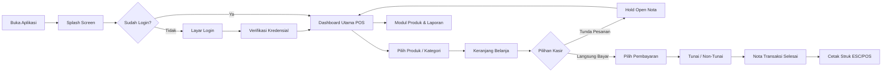

# 📱 Smart POS App - Automated E2E Testing & UAT Suite
### Ujian Tengah Semester (UTS) Mata Kuliah Mobile Testing
**Fakultas Ilmu Komputer, Universitas Duta Bangsa Surakarta**  
**Tahun Akademik 2026/2027**

---

## 👤 Informasi Mahasiswa & Proyek

| Informasi | Keterangan |
| :--- | :--- |
| **Mata Kuliah** | Mobile Testing |
| **Dosen Pengampu** | Triyono M.Kom |
| **Program Studi** | S1 Teknik Informatika |
| **Kelas** | TI23B |
| **Nama Mahasiswa** | AFIF ADAM MUGHNANSYAH |
| **NIM** | 230103184 |
| **Peran** | Mobile App Developer & QA / Automated Tester |
| **Tautan Repository Git** | `[Isi tautan GitHub / GitLab Anda di sini]` |
| **Tautan Video Penjelasan** | `[Isi tautan video demonstrasi (durasi 5–10 menit) di sini]` |

---

## 📖 1. Gambaran Umum Aplikasi (Smart POS)

### A. Tujuan Aplikasi
**Smart POS (Point of Sale)** adalah aplikasi kasir modern berbasis Flutter yang dirancang untuk membantu Usaha Mikro, Kecil, dan Menengah (UMKM), kafe, ritel, serta restoran dalam mencatat pesanan, memproses transaksi secara real-time, mengelola nota gantung (*Open Nota / Hold Bill*), mencetak struk thermal ESC/POS, dan memantau analitik omset penjualan secara akurat dan efisien.

### B. Target Pengguna
1. **Kasir (Cashier)**: Pengguna operasional yang membutuhkan antarmuka responsif, cepat, minim klik, dan mudah digunakan untuk menangani antrean transaksi harian.
2. **Manajer Toko / Pemilik Bisnis**: Pengguna administratif yang mengelola inventaris produk (harga dan stok) serta memantau performa penjualan dan riwayat transaksi.

### C. Fitur Utama
- 🔐 **Autentikasi Multi-User**: Login kasir terintegrasi Supabase Auth dengan penanganan error interaktif.
- 🛍️ **Katalog Real-Time & Search**: Pencarian instan dan penyaringan produk berdasarkan kategori.
- 🛒 **Manajemen Keranjang Fleksibel**: Tambah kuantitas, ubah jumlah pesanan, dan kalkulasi subtotal instan.
- 📝 **Open Nota (Hold & Retrieve)**: Simpan sementara keranjang belanja pelanggan dan muat kembali kapan saja.
- 💳 **Metode Pembayaran Ganda**: Dukungan transaksi Tunai (*Cash*) dengan preset uang pas & hitung kembalian, serta Non-Tunai (*QRIS / EDC*).
- 🖨️ **Cetak Struk ESC/POS**: Preview dan pencetakan struk transaksi thermal ukuran 58mm / 80mm via Bluetooth/USB.
- 📦 **Manajemen Produk (CRUD)**: Tambah, perbarui harga/stok, dan hapus katalog produk secara langsung.
- 📊 **Laporan & Analitik**: Dashboard ringkasan total omset, jumlah transaksi, rata-rata belanja, dan export PDF/Excel.
- 📱 **Desain Responsif**: Otomatis menyesuaikan tampilan pada Smartphone (*Mobile Portrait Bottom Sheet*) dan Tablet (*Landscape Split-Screen*).

### D. Alur Pengguna (User Flow)


### E. Batasan Pengujian
1. Pengujian dilakukan pada platform Android (Emulator API level 30+ atau perangkat fisik Android).
2. Fitur cetak fisik diuji melalui generator preview ESC/POS dan mocking dialog pencetakan printer thermal.
3. Kredensial pengujian menggunakan akun kasir terdaftar di backend Supabase.

---

## 📋 2. User Acceptance Testing (UAT)

Pengujian UAT mencakup **20 skenario pengujian** yang menguji alur utama (*happy path*), responsivitas perangkat, alur transaksi, cetak struk, hingga validasi kondisi gagal.

- 📄 **Dokumen Spreadsheet Lengkap**: [`UAT_Interactive_Smart_POS_App.xlsx`](file:///c:/xampp/htdocs/FLUTTER/UDB/udb_3/UAT_Interactive_Smart_POS_App.xlsx)
- 📝 **Laporan Ringkasan Markdown**: [`UAT_REPORT.md`](file:///c:/xampp/htdocs/FLUTTER/UDB/udb_3/UAT_REPORT.md)

---

## 🤖 3. Automate Testing Menggunakan Maestro

Sesuai ketentuan teknis UTS, otomatisasi pengujian disusun menggunakan **Maestro E2E Testing Framework** dan memuat skenario yang mencakup 4 pilar utama:

| No | Pilar Ketentuan UTS | Skenario / Flow Maestro | File YAML | Keterangan Verifikasi (Assertion) |
|:--:|:--------------------|:------------------------|:----------|:----------------------------------|
| 1 | **Pembukaan Aplikasi** | AUTH-01 Splash Screen | [`maestro/auth/AUTH_01_splash_screen.yaml`](file:///c:/xampp/htdocs/FLUTTER/UDB/udb_3/maestro/auth/AUTH_01_splash_screen.yaml) | Memverifikasi logo splash, delay auto-check sesi, dan transisi ke dashboard / login. Dilengkapi `takeScreenshot`. |
| 2 | **Navigasi Aplikasi** | NAV-01 Navigation Bar | [`maestro/navigation/NAV_01_navigation_bar.yaml`](file:///c:/xampp/htdocs/FLUTTER/UDB/udb_3/maestro/navigation/NAV_01_navigation_bar.yaml) | Menguji perpindahan antar modul utama (POS, Produk, Laporan, Akun) secara berurutan. Dilengkapi `takeScreenshot`. |
| 3 | **Alur Transaksi / CRUD** | PAY-01 & PRD-01 | [`maestro/payment/PAY_01_pembayaran_tunai.yaml`](file:///c:/xampp/htdocs/FLUTTER/UDB/udb_3/maestro/payment/PAY_01_pembayaran_tunai.yaml)<br>[`maestro/products/PRD_01_tambah_produk.yaml`](file:///c:/xampp/htdocs/FLUTTER/UDB/udb_3/maestro/products/PRD_01_tambah_produk.yaml) | **Transaksi**: Tambah item ke cart, checkout tunai uang pas, validasi kembalian dan nota transaksi.<br>**CRUD**: Input form tambah produk baru, validasi produk muncul di katalog. Dilengkapi `takeScreenshot`. |
| 4 | **Validasi Kesalahan** | AUTH-04 Form & Credential Error | [`maestro/auth/AUTH_04_validasi_error.yaml`](file:///c:/xampp/htdocs/FLUTTER/UDB/udb_3/maestro/auth/AUTH_04_validasi_error.yaml) | Menguji form login kosong, format email tanpa `@`, password < 6 karakter, dan login gagal dengan password salah. Dilengkapi assertion pesan error & `takeScreenshot`. |

### Struktur Direktori Folder `maestro/`
```text
maestro/
├── common/                               # Subflow Reusable
│   ├── launch_app.yaml                   # Buka aplikasi & tunggu splash
│   └── ensure_logged_in.yaml             # Verifikasi kondisi login kasir
├── auth/                                 # Modul Autentikasi
│   ├── AUTH_01_splash_screen.yaml        # [Wajib] Pembukaan aplikasi
│   ├── AUTH_02_register_toko.yaml        # Pendaftaran akun toko
│   ├── AUTH_03_login_kasir.yaml          # Login kasir sukses
│   └── AUTH_04_validasi_error.yaml       # [Wajib] Validasi kesalahan input & form
├── navigation/                           # Modul Navigasi
│   └── NAV_01_navigation_bar.yaml        # [Wajib] Alur navigasi antar menu
├── payment/                              # Modul Pembayaran / Transaksi
│   ├── PAY_01_pembayaran_tunai.yaml      # [Wajib] Alur transaksi pembayaran tunai
│   └── PAY_02_pembayaran_non_tunai.yaml  # Alur transaksi QRIS / non-tunai
├── products/                             # Modul Produk (CRUD)
│   ├── PRD_01_tambah_produk.yaml         # [Wajib] Alur CRUD tambah produk baru
│   └── PRD_02_edit_hapus_produk.yaml     # Alur edit dan hapus produk
├── pos/                                  # Modul Point of Sale
│   ├── POS_01_katalog_filter.yaml        # Pencarian dan filter kategori
│   ├── POS_02_keranjang_belanja.yaml     # Operasi keranjang (+/- qty)
│   ├── POS_03_open_nota_hold.yaml        # Simpan nota sementara (Hold)
│   └── POS_04_open_nota_retrieve.yaml    # Muat nota terbuka (Retrieve)
├── print/                                # Modul Struk ESC/POS
│   ├── PRT_01_cetak_struk.yaml           # Cetak struk printer Bluetooth 58/80mm
│   └── PRT_02_reprint_struk.yaml         # Cetak ulang struk dari riwayat
├── reports/                              # Modul Laporan
│   ├── REP_01_laporan_penjualan.yaml     # KPI omset & filter waktu
│   └── REP_02_riwayat_transaksi.yaml     # Riwayat transaksi completed
├── responsive/                           # Modul Responsive Layout
│   ├── RESP_01_mobile_portrait.yaml      # Layout Smartphone
│   └── RESP_02_tablet_landscape.yaml     # Layout Tablet Split-Screen
├── screenshots/                          # Folder tangkapan layar otomatis Maestro
│   └── .gitkeep
├── run_all_uat.yaml                      # Master Suite untuk menjalankan seluruh pengujian
└── README.md                             # Dokumentasi teknis Maestro
```

---

## 🛠️ 4. Panduan Menjalankan Aplikasi & Pengujian

### A. Prasyarat Sistem
- **Flutter SDK**: Versi >= 3.11.1 (Channel stable)
- **Android SDK & Platform Tools**: `adb` aktif
- **Maestro CLI**: Terinstal di sistem

### B. Menjalankan Aplikasi Flutter
1. Ambil dependensi:
   ```powershell
   flutter pub get
   ```
2. Pastikan emulator Android atau perangkat fisik menyala:
   ```powershell
   adb devices
   ```
3. Jalankan aplikasi:
   ```powershell
   flutter run
   ```

### C. Menjalankan Automate Testing Maestro
1. **Instalasi Maestro CLI** (jika belum terpasang):
   - **Windows (PowerShell)**:
     ```powershell
     powershell -ExecutionPolicy ByPass -c "irm https://get.maestro.mobile.dev | iex"
     ```
   - **macOS / Linux**:
     ```bash
     curl -Ls "https://get.maestro.mobile.dev" | bash
     ```

2. **Menjalankan 4 Flow Utama UTS**:
   ```powershell
   # 1. Pembukaan Aplikasi
   maestro test maestro/auth/AUTH_01_splash_screen.yaml

   # 2. Navigasi Aplikasi
   maestro test maestro/navigation/NAV_01_navigation_bar.yaml

   # 3. Alur Transaksi / CRUD
   maestro test maestro/payment/PAY_01_pembayaran_tunai.yaml
   maestro test maestro/products/PRD_01_tambah_produk.yaml

   # 4. Validasi Kesalahan
   maestro test maestro/auth/AUTH_04_validasi_error.yaml
   ```

3. **Menjalankan Seluruh Suite Pengujian Sekaligus**:
   ```powershell
   maestro test maestro/run_all_uat.yaml
   ```

4. **Merekam Video Eksekusi Pengujian (Maestro Record)**:
   ```powershell
   maestro record maestro/payment/PAY_01_pembayaran_tunai.yaml
   ```

---

## 📦 5. Struktur Repository & Riwayat Git Commit

Repository ini disusun dengan menerapkan praktik version control Git yang rapi dengan minimal **5 commit bermakna**:
1. `feat: initial flutter project setup, dependencies, and core architecture`
2. `feat: implement smart pos core features, catalog, cart, and supabase backend integration`
3. `docs: add comprehensive user acceptance testing (UAT) scenarios and test cases`
4. `test(maestro): add e2e mobile test suite with 18 flows covering auth, navigation, pos, and responsive layout`
5. `test(maestro): implement error validation flow, assertions, screenshots, and complete UTS README documentation`

---

## ⚖️ Lisensi & Hak Cipta
Proyek ini dibuat untuk keperluan Ujian Tengah Semester (UTS) Mata Kuliah Mobile Testing pada Program Studi S1 Teknik Informatika, Fakultas Ilmu Komputer, Universitas Duta Bangsa Surakarta.
